<p align="center">
  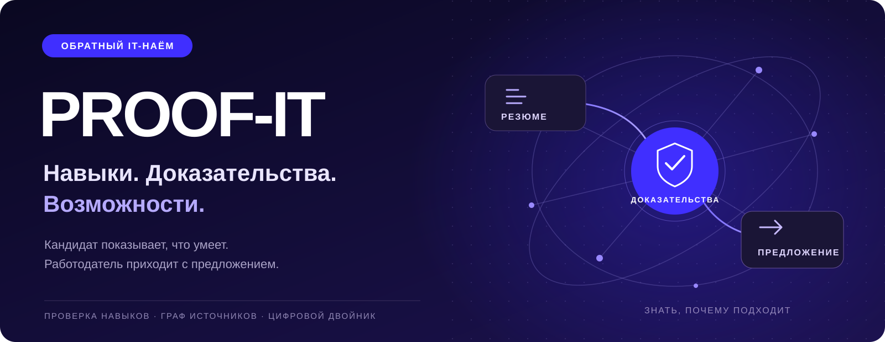
</p>

# PROOF-IT / ПРУФ-ИТ

**Обратный IT-найм на основе проверяемых профессиональных доказательств.**

Передовая графовая модель доказательств и система цифровых двойников помогают компании выбирать оптимальный сценарий найма по срокам и бюджету, а кандидату – строить персональный карьерный маршрут, сопоставляя подтверждённый опыт с подходящими ролями, желаемыми условиями, расчётными сроками поиска работы с учётом текущих особенностей рынка.

[Запуск](docs/GETTING_STARTED.md) · [Проверка за 15 минут](docs/REVIEW_GUIDE.md) · [Архитектура и код](docs/REPOSITORY_MAP.md) · [OpenAPI](data/contracts/openapi.json) · [Инженерное досье](docs/00_Engineering_Dossier.pdf)

Проект объединяет адаптивное тестирование, практические задания, цифровые двойники и граф происхождения доказательств. Основные проверки и подбор работают на CPU; языковые модели помогают с разбором документов и объяснениями.

**Статус:** функциональный прототип с инженерной валидацией. Синтетические испытания не доказывают эффективность найма реальных людей. Официальные ФСП/Dream Job данные и промышленная калибровка требуют отдельного подключения и проверки.

## Интерфейс: от входа до предложения

Все восемь изображений **заново сняты 11 октября 2026 года** в Chromium с работающего приложения. Профили, вакансия и предложение — синтетические демонстрационные данные. Тестовый сертификат создан контролируемым прогоном API и не подтверждает квалификацию человека. Нажмите на изображение, чтобы открыть полный размер.

<table>
  <tr>
    <td width="50%" valign="top">
      <h3>01 · Вход</h3>
      <a href="docs/assets/screenshots/01-login.png">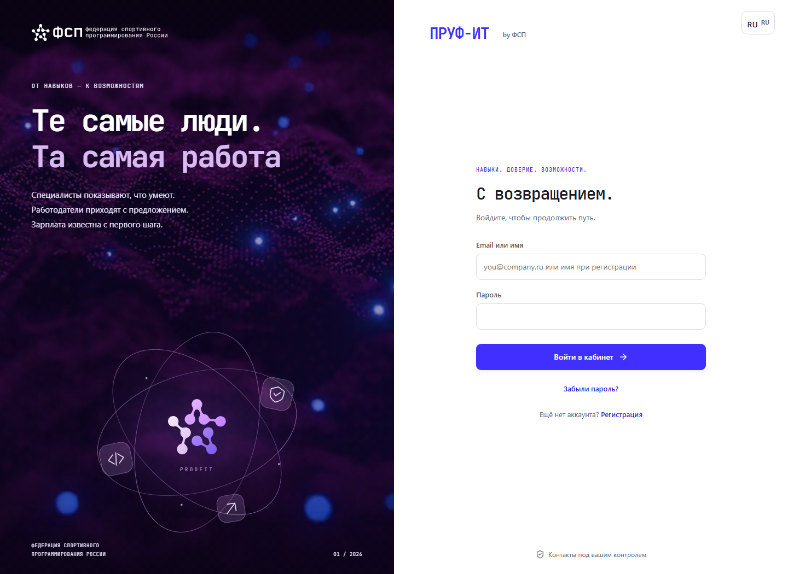</a>
      <p>Единая авторизация для двух ролей. Декоративная сцена остаётся на странице входа; кабинет открывается после проверки сессии.</p>
    </td>
    <td width="50%" valign="top">
      <h3>02 · Целевое резюме</h3>
      <a href="docs/assets/screenshots/02-resume.png">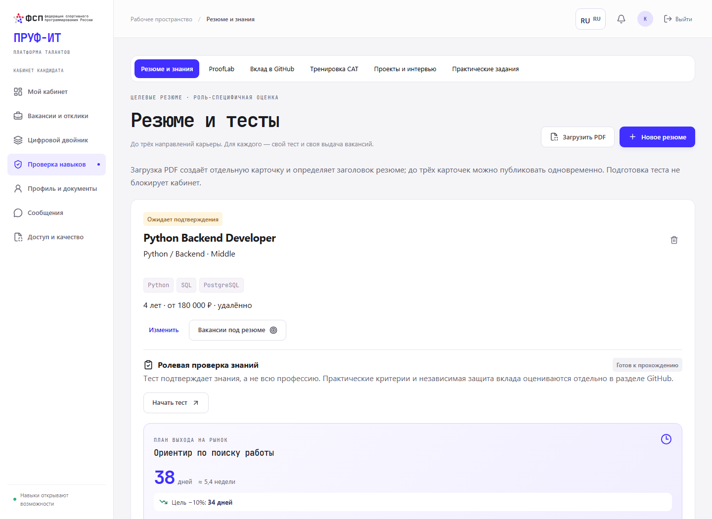</a>
      <p>До трёх карьерных целей: у каждой своя роль, грейд, стек и проверка знаний. В этом кадре доступ к поиску работодателя ещё ожидает подтверждения.</p>
    </td>
  </tr>
  <tr>
    <td width="50%" valign="top">
      <h3>03 · Адаптивная проверка</h3>
      <a href="docs/assets/screenshots/03-assessment.png">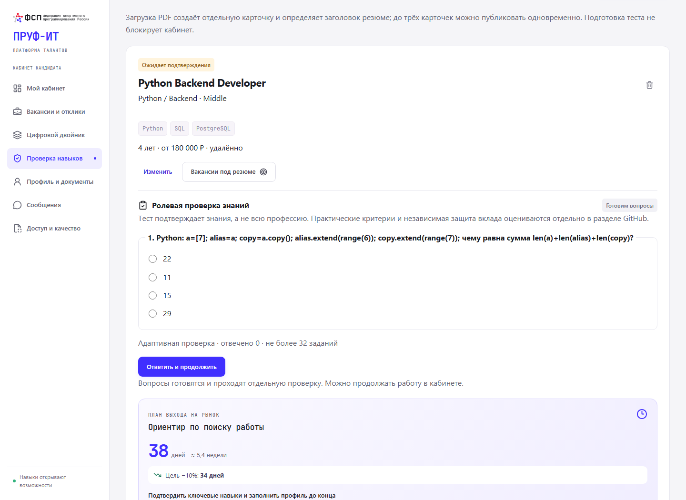</a>
      <p>Один вопрос за шаг; сервер выбирает следующее задание по ответам. Подтверждаются знания роли. Практика и независимая защита вклада оцениваются отдельно.</p>
    </td>
    <td width="50%" valign="top">
      <h3>04 · Граф доказательств</h3>
      <a href="docs/assets/screenshots/04-proof-graph.png">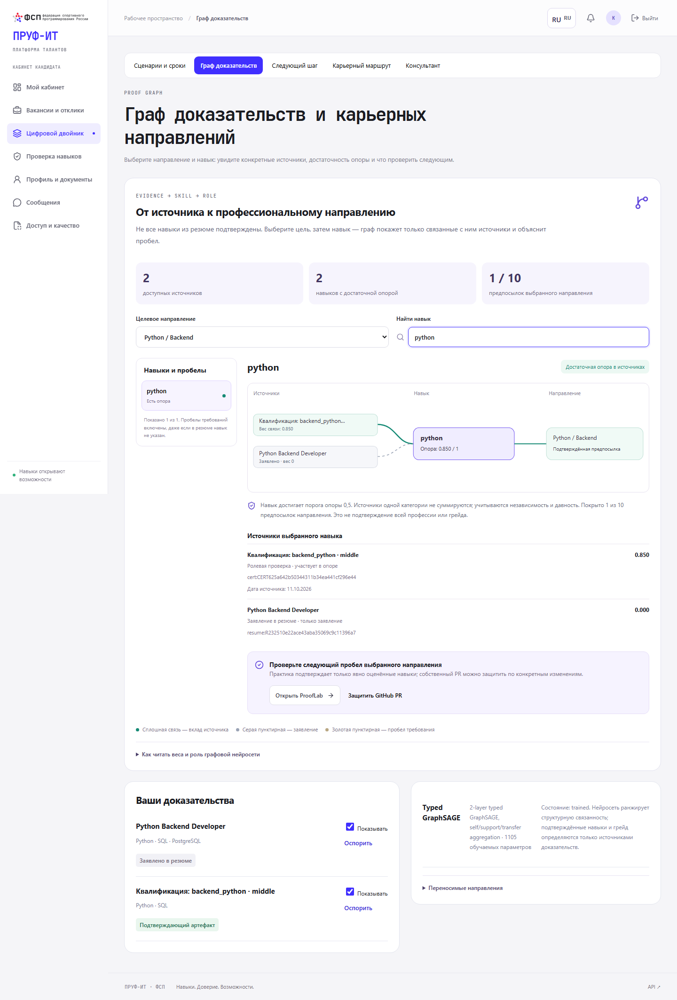</a>
      <p>Источник → навык → направление. Проверенный артефакт имеет опору; запись в резюме остаётся заявлением. Видны пробелы и управление видимостью источников.</p>
    </td>
  </tr>
  <tr>
    <td width="50%" valign="top">
      <h3>05 · Цифровой двойник</h3>
      <a href="docs/assets/screenshots/05-digital-twin.png">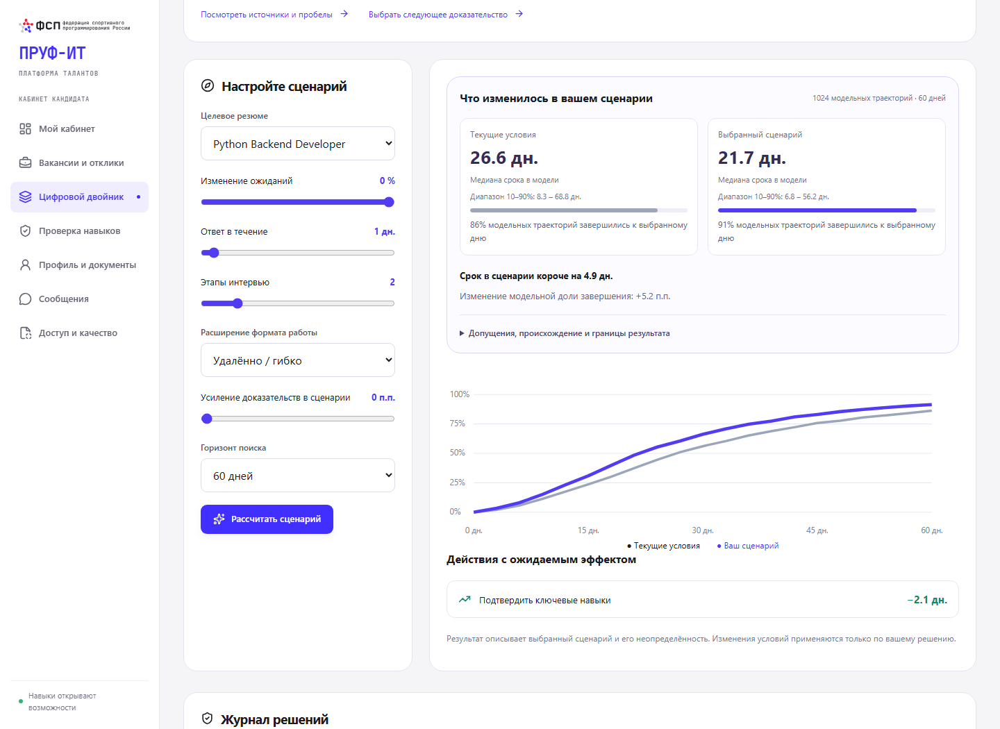</a>
      <p>Сравнение текущих условий с ответом за один день и двумя этапами интервью. Сроки и диапазоны — выход сценарной модели, а не обещание трудоустройства.</p>
    </td>
    <td width="50%" valign="top">
      <h3>06 · Подбор работодателя</h3>
      <a href="docs/assets/screenshots/06-employer-search.png">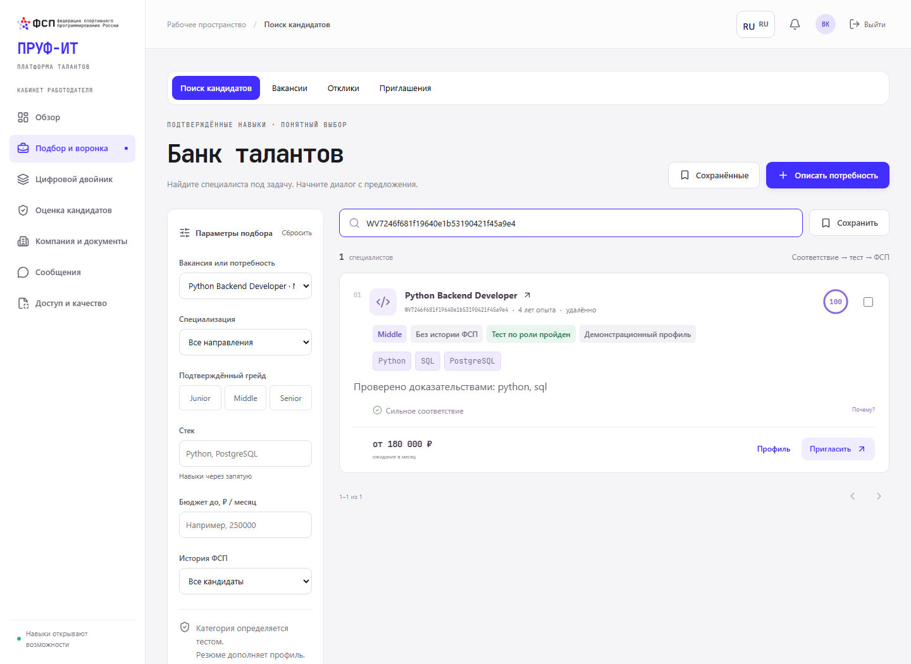</a>
      <p>Вакансия задаёт контекст подбора. Работодатель видит допуск, стек, ожидания и соответствие; в кадре поиск ограничен ID демонстрационного профиля.</p>
    </td>
  </tr>
  <tr>
    <td width="50%" valign="top">
      <h3>07 · Предложение с условиями</h3>
      <a href="docs/assets/screenshots/07-employer-offer.png">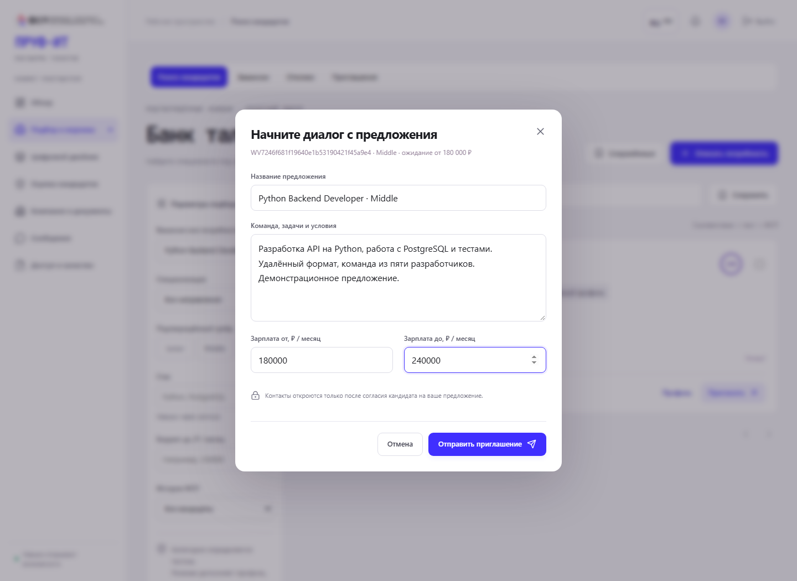</a>
      <p>Диалог начинается с задач и зарплатной вилки. До отправки явно указаны роль, формат работы и условия раскрытия контактов.</p>
    </td>
    <td width="50%" valign="top">
      <h3>08 · Решение кандидата на телефоне</h3>
      <p align="center"><a href="docs/assets/screenshots/08-candidate-offer-mobile.png">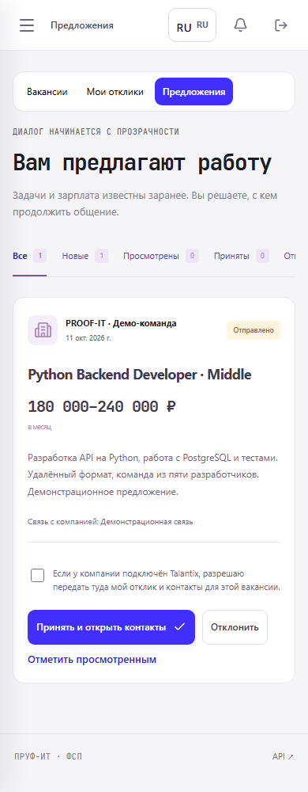</a></p>
      <p>Кандидат получает то же предложение и выбирает, продолжать ли общение. Передача контактов в подключённую ATS требует отдельного согласия.</p>
    </td>
  </tr>
</table>

[Происхождение и обновление снимков](docs/SCREENSHOTS.md) · [Протокол съёмки и SHA-256](docs/assets/screenshots/capture.json)

## Путь кандидата и работодателя

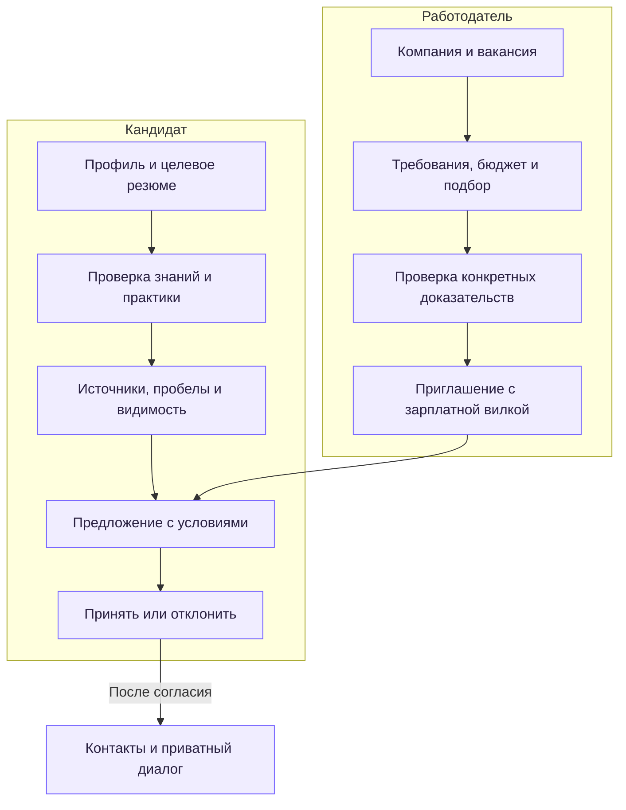

Цифровой двойник доступен обеим сторонам: кандидат сравнивает карьерные условия, работодатель — параметры найма. Расчёт сценария не меняет резюме, вакансию или подтверждённый грейд.

## Компактная архитектура

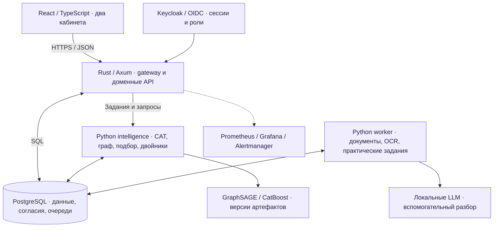

Входные документы и артефакты проходят обработку в очередях. API проверяет роль, владельца и согласия; источники сохраняют происхождение, область действия и статус отзыва. Подробные границы сервисов и модули: [карта репозитория](docs/REPOSITORY_MAP.md), [архитектура](docs/01_Architecture.pdf).


## Быстрая навигация

| Задача | Материал |
|---|---|
| Подготовить окружение и запустить | [Инструкция запуска](docs/GETTING_STARTED.md) |
| Проверить сквозной продуктовый сценарий | [Сценарий демонстрации](docs/REVIEW_GUIDE.md) |
| Разобраться в структуре и границах сервисов | [Карта репозитория](docs/REPOSITORY_MAP.md) |
| Изучить архитектуру, методы и эксплуатацию | [Инженерное досье](docs/00_Engineering_Dossier.pdf) |
| Проверить API | [OpenAPI 3.1](data/contracts/openapi.json), `/api/openapi.json` |
| Проверить результаты и ограничения | [Валидация](docs/07_Validation.pdf), [протоколы](validation/reports/current/) |
| Изучить подробное описание возможностей | [Обзор проекта](docs/PROJECT_OVERVIEW.md) |
| Сопоставить с четырьмя решениями спецтрека | [Экспертное сравнение](docs/COMPARISON.md) |

## Возможности

| Контур | Реализация |
|---|---|
| Подтверждение квалификации | CAT/EAP, параметризованные задания, контроль повторов, сертификаты с областью действия, независимый разбор |
| Практические доказательства | Python/SQL/TypeScript задания, ограниченное исполнение, артефакты проектов, привязка GitHub-доказательств к версии |
| Объяснимый подбор | Подтверждённая категория, согласия и обязательные требования; причины соответствия и пробелы |
| Цифровые двойники | Сценарии what-if, следующий полезный шаг, карьерные маршруты, модели сроков и неопределённости |
| Граф доказательств | Источник, срок действия, отзыв и приватность; обучаемый типизированный GraphSAGE и ограниченный fallback |
| Обратный наём | Приглашения с вилкой, принятие/отказ, вакансии, отклики, приватная переписка |
| Исследование решений | A/B-формы, наблюдаемые ответы сторон, фиксация прогноза до исхода и неизменяемый журнал |
| Эксплуатация | Keycloak/OIDC + PKCE, роли и ownership, Prometheus/Grafana/Alertmanager, резервное копирование |
| Интерфейс | React/TypeScript, адаптивные кабинеты, RU/EN/KK/UZ/AZ/BE, контроль целостности переводов |

## Технологии и структура

```text
src/                   Rust, Axum, SQLx: API, доступ, доменные операции и gateway
web/                   React 19, TypeScript, Vite: два кабинета и локализация
intelligence/          Python: CAT, граф, двойники и исследование решений
worker/                Документы, OCR, очереди и практические задания
ml_time_forecasting/   CatBoost: артефакты и сервис прогнозирования сроков
migrations/            Версионированные SQL-миграции PostgreSQL
data/                  Сценарные данные, таксономия и API-контракты
deploy/                Docker, production-конфигурация, Keycloak, Helm, мониторинг
tests/                 Численные, API, security и UI-проверки
validation/            Протоколы и машиночитаемые результаты
docs/                  Инструкции и 14 тематических PDF
research/              Реестр первичных источников и лицензионные материалы
```

Внутреннее имя Rust-бинарника — `fsp-trajectory`; имя репозитория и продукта — PROOF-IT.

## Запуск и проверка

Нужны Python 3.12, Node.js 24, Rust с поддержкой проекта, PostgreSQL 17 и Docker Desktop для Keycloak/изолированного исполнения. Для проверки алгоритмов и сборки рабочая БД не требуется.

```powershell
git clone https://github.com/GreyLs/PROOF-IT.git
cd PROOF-IT
py -3.12 -m venv .venv
.\.venv\Scripts\python.exe -m pip install -r requirements.lock.txt -r requirements.forecasting.txt -r requirements.intelligence.txt
cargo test --locked
Push-Location web
npm ci
npm run build
Pop-Location
```

Полный запуск с подготовкой БД и identity: [GETTING_STARTED.md](docs/GETTING_STARTED.md). Учётные данные и адрес частного стенда передаются отдельно; рабочих секретов в репозитории нет.

## Проверяемые результаты

Сохранённый прицельный срез: **405 CPU-проверок**, **70 live HTTP-проверок**, **18 Rust unit-проверок** и **36 браузерных сценариев** допуска на шести языках. Область каждого запуска, дата и пропуски отражены в протоколах; повторные запуски не суммируются. Это сохранённые измерения, а не обещание промышленного SLA.

| Измерение | Сохранённый результат | Граница вывода |
|---|---|---|
| Подбор работодателя | Precision@5 100%, nDCG@5 98,15%; 494 сценарные вакансии | Авторская контрольная разметка, не реальные кадровые исходы |
| Ограниченная нагрузка | 30 сессий, 4039 запросов, 0 ошибок; P95 395,93 ms | Локальный paced workload; без OCR/LLM и экстраполяции |
| GraphSAGE | 1105 параметров, MAE 0,002942 на 80 контрольных графах | Аппроксимация структурного teacher, не прогноз фактического найма |
| Ключи практических заданий | 720 исполняемых Python/SQL/TypeScript проверок | Проверка корректности заданий, не человеческая калибровка |

Подробные методики, отрицательные сценарии и ограничения: [07_Validation.pdf](docs/07_Validation.pdf). Проверки текущей копии для GitHub хранятся отдельно в `validation/reports/publication/`.

## Разработка и сопровождение

- [Правила изменения проекта](CONTRIBUTING.md): зависимости, миграции, проверки и доказательства результата.
- [Безопасность](SECURITY.md): приватное сообщение об уязвимостях и управление секретами.
- GitHub Actions проверяет Rust, веб-сборку и детерминированный CPU-контур.
- [Лицензия](LICENSE): Apache-2.0; уведомления о сторонних компонентах сохраняются рядом с материалами.

Сопровождение репозитория: **Arkady**.
