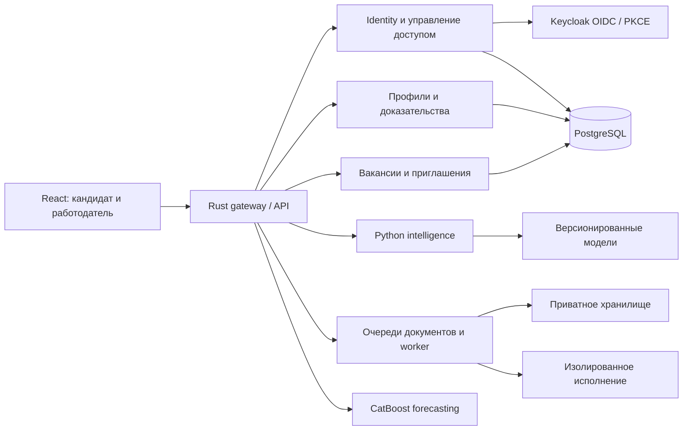

# Карта репозитория

## Сервисы и границы ответственности

Схема показывает логические границы. Нативный gateway и deployment-профили позволяют разделять сервисы; она не доказывает независимое горизонтальное масштабирование всей системы.

| Задача | Основные файлы |
|---|---|
| Доступ, сессии, безопасность | `src/auth.rs`, `src/account.rs`, `src/security.rs`, `src/service.rs` |
| Профили и согласия | `src/resumes.rs`, `src/interactions.rs`, `src/matching.rs` |
| CAT и сертификаты | `src/certification.rs`, `intelligence/professional.py`, `intelligence/item_bank.py` |
| Доказательства и граф | `src/evidence.rs`, `intelligence/certification.py`, `intelligence/graph_neural.py` |
| Двойники и сценарии | `intelligence/twins.py`, `intelligence/engine.py`, `intelligence/market_models.py` |
| Личный вклад и артефактная защита | `src/research_lab.rs`, `intelligence/github_evidence.py`, `intelligence/role_matrix.py` |
| Эксперимент и будущие исходы | `intelligence/experiments.py`, `intelligence/prospective.py`, `migrations/0033*`, `migrations/0034*` |
| Документы и исполнение | `worker/extraction.py`, `worker/pdf_layout.py`, `worker/workbench.py` |
| Интеграции | `src/providers.rs`, `src/talantix.rs`, `intelligence/providers.py` |
| Интерфейс и языки | `web/src/navigation.tsx`, `web/src/main.tsx`, `web/src/locales/` |
| Мониторинг | `scripts/monitoring_exporter.py`, `deploy/monitoring/`, `docs/13_Observability_and_Monitoring.pdf` |

## Данные и артефакты

`data/` содержит сценарный набор, а не рабочую пользовательскую БД. `intelligence/artifacts/` и `ml_time_forecasting/artifacts/` содержат обученные артефакты с описанием происхождения и контрольными суммами. `validation/reports/current/` сохраняет исходные протоколы испытаний; `validation/reports/publication/` относится к подготовке этой копии для GitHub.

`runtime/`, `.env`, `deploy/secrets/`, локальные модели и временные адреса доступа исключены из Git. Текущий snapshot публикуется отдельной историей; исходная локальная история проекта не переносится.

## Документация

Входной документ — [00_Engineering_Dossier.pdf](00_Engineering_Dossier.pdf). Тематические PDF покрывают архитектуру, методы, двойники, граф, угрозы, приватность, валидацию, API, исследование, данные, интерфейс, кадровые решения и мониторинг. [PROJECT_OVERVIEW.md](PROJECT_OVERVIEW.md) сохраняет развёрнутое описание текущего продукта.
